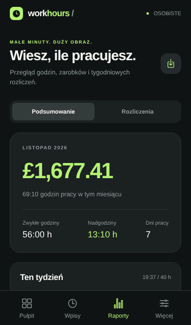

# Work Hours

Osobista aplikacja do ewidencji czasu i zarobków na **Androida i iPhone'a**, napisana w React Native / Expo / TypeScript. Interfejs po polsku, domyślna waluta **GBP**. Działa offline, bez kont i reklam. Dane na każdym urządzeniu są oddzielne.

## Podgląd

Zrzuty podglądu przeglądarkowego na ekranie telefonu, z danymi przykładowymi:

<p>
  
  
  
</p>

## Funkcje wersji 1

- Projekty / pracodawcy z własną stawką, kolorem i dziennymi zasadami nadgodzin.
- Start od teraz lub wybranej godziny, niepłatne przerwy, wznowienie i zakończenie zmiany. Licznik zachowuje czas po zamknięciu aplikacji dzięki zapisanym znacznikom czasu.
- Ręczne dodawanie, edycja i usuwanie wpisów, notatki i walidacja nakładających się zmian.
- Przegląd według dni, tygodni, miesięcy i projektów, wyszukiwanie i filtrowanie.
- Obliczanie zwykłych godzin i nadgodzin po odjęciu przerw, z dziennym limitem wspólnym dla kilku zmian w tym samym projekcie.
- Rozdzielanie zmian nocnych na dni raportu. Obliczenia czasu uwzględniają zmianę czasu letniego/zimowego.
- Raport miesiąca, wykres tygodniowy i tygodniowe okresy rozliczeniowe z ręcznym oznaczeniem wypłaty.
- Eksport wszystkich danych ewidencji do CSV, kopia JSON, przywracanie pliku po walidacji i potwierdzeniu.
- Archiwizacja projektów bez usuwania historii. Stawki zapisane przy wpisach zachowują się po zmianie ustawień projektu.
- Opcjonalne, jawnie wczytywane dane przykładowe Bowmill.

## Uruchomienie na telefonie

Wymagane: Node.js 22.13+ (sprawdzono na Node 24), npm i Expo Go zgodne z **Expo SDK 58**.

```sh
npm ci
npm start
```

Zainstaluj zgodne Expo Go na telefonie. Telefon i komputer powinny być w tej samej sieci. Na Androidzie zeskanuj kod QR w Expo Go, na iPhonie aparatem systemowym. Jeśli wydanie Expo Go w sklepie nie obsługuje jeszcze tej wersji SDK, użyj własnego buildu opisanym poniżej. Uruchomienie Expo w tym zdalnym środowisku nie oznacza automatycznie dostępności serwera z telefonu.

Podgląd przeglądarkowy:

```sh
npm run web
```

## Własny plik instalacyjny Android / iOS

Projekt ma konfigurację EAS; nie jest jeszcze powiązany z kontem Expo ani podpisany. Przed kompilacją użyj własnego konta Expo i zatwierdź identyfikatory aplikacji w `app.json`. `eas init` zapisze identyfikator Twojego projektu.

```sh
npx eas-cli login
npx eas-cli init
npx eas-cli build --platform android --profile preview
```

Profil `preview` tworzy **APK**, które można zainstalować bez Google Play. Dla iPhone'a:

```sh
npx eas-cli device:create
npx eas-cli build --platform ios --profile preview
```

Instalacja iOS na urządzeniu przez dystrybucję wewnętrzną wymaga konta Apple Developer, certyfikatu i rejestracji urządzenia. Alternatywnie testuj w Expo Go. Kompilacje produkcyjne dla Google Play / TestFlight / App Store:

```sh
npx eas-cli build --platform all --profile production
```

Publikacja w sklepach jest osobnym etapem, wymagającym kont właściciela, podpisów i metadanych sklepowych. W tym repozytorium nie ma kluczy ani danych logowania.

## Zasady obliczeń i danych

- Domyślnie nadgodziny zaczynają się po 8 godzinach płatnej pracy dziennie, mnożnik 1,25. Dla każdego projektu można to zmienić. To proste reguły użytkownika, nie automatyczne odwzorowanie prawa pracy ani umowy.
- Przerwy są niepłatne. Przy wpisie ręcznym przerwa jest umieszczana na końcu zmiany; przy liczniku zapisywane są rzeczywiste przedziały przerw.
- Zmiany nocne są dzielone w raportach na dni według lokalnej strefy telefonu, przy zachowaniu jednej edytowalnej zmiany źródłowej. CSV zawiera osobny wiersz dla każdego dnia zmiany.
- Historia korzysta ze stawki i mnożnika zapisanych przy wpisie. Przy zmianie projektu istniejącego wpisu używane są reguły nowego projektu. Aktywny licznik zachowuje reguły z momentu startu.
- Raportowane zarobki nie uwzględniają podatków, potrąceń ani przewalutowania. Zmiana waluty zmienia oznaczenie wszystkich kwot po potwierdzeniu, nie przelicza wartości.
- Tygodnie: poniedziałek–niedziela. „Opłacono” jest wyłącznie ręczną notatką dotyczącą danego tygodnia; edycja późniejszych wpisów zmienia jego sumę.
- Raporty finansowe obejmują zakończone zmiany. Karta „Dzisiaj” dodaje czas aktywnego licznika; jego zarobki trafiają do raportu po zakończeniu.
- Zapis przez AsyncStorage jest lokalny i nie stanowi szyfrowanego sejfu. Usunięcie aplikacji / danych przeglądarki może usunąć ewidencję. Regularnie zapisuj JSON w bezpiecznym miejscu.
- Przeniesienie między Androidem i iPhonem: zapisz kopię JSON, prześlij plik na drugi telefon i użyj „Przywróć z pliku”. Przywrócenie zastępuje obecne dane. Nie ma automatycznej synchronizacji.

## Kontrole

```sh
npm run typecheck
npm test
npm run export
npm run test:e2e
npx expo-doctor
```

`npm run export` sprawdza bundlowanie JS/Hermes dla Androida, iOS i web; nie tworzy podpisanego pliku APK/IPA. Testy domeny sprawdzają naliczanie nadgodzin, podział o północy, zmianę czasu, walidację kopii i eksport. Testy Playwright wymagają zainstalowanego Chromium (`CHROMIUM_PATH`, domyślnie `/usr/bin/chromium`), Pythona 3 i wcześniejszego eksportu do `dist`. Przechodzą przez tworzenie projektu, wpisy, błąd walidacji, przerwę i odtworzenie licznika, rozliczenia i eksport. Zrzuty zapisują do ignorowanego katalogu `artifacts`.

## Zakres i dalsze kroki

To pierwsza działająca wersja oparta na funkcjach ewidencji widocznych na przekazanych zdjęciach i w opisie [WorkingHours](https://play.google.com/store/apps/details?id=partl.workinghours). Nie jest pełną kopią produktu. Nie zawiera GPS/geofencingu, NFC, widżetów systemowych, sterowania w powiadomieniu, synchronizacji chmurowej, integracji kalendarzy, faktur PDF, Pomodoro ani eksportu XLSX. Nie uruchomiono jej jeszcze na fizycznym Androidzie lub iPhonie — wymagane są testy na urządzeniach przed użyciem produkcyjnym.

Kod: `src/domain.ts` — obliczenia i walidacja, `src/storage.ts` — zapis, `src/files.ts` — import i eksport, `App.tsx` — interfejs.
