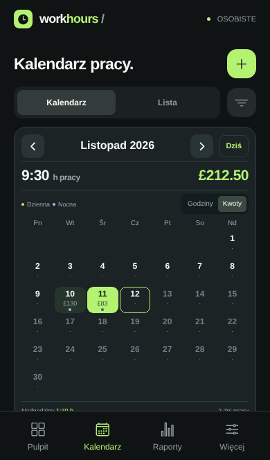

# Work Hours

Osobista aplikacja do ewidencji czasu i zarobków na **Androida i iPhone'a**, napisana w React Native / Expo / TypeScript. Interfejs po polsku, domyślna waluta **GBP**. Działa offline, bez kont i reklam. Dane na każdym urządzeniu są oddzielne.

## Wersja 1.9 — nadgodziny tygodniowe i przerwy

Nadgodziny nowych i aktywnych zmian zaczynają się **wyłącznie po normie tygodniowej** miejsca pracy, np. 39:00. Cel pojedynczej zmiany nie uruchamia nadgodzin. Każde miejsce zachowuje swoją wcześniej ustawioną normę; jeśli jej nie miało, początkowo wynosi 40:00 — wpisz właściwą przez **Zmień normę** na pulpicie.

Dotychczasowe wpisy zachowują swoje zasady i kwoty. Aby poprawić je na normę tygodniową, wybierz **Przelicz wcześniejsze wpisy**, wpisz normę i potwierdź. Przeliczenie obejmuje wszystkie wpisy tego miejsca pracy; stawki i przerwy zostają, ale zarobki i nadgodziny mogą się zmienić. Ręczne oznaczenia wypłat nie są zmieniane. Przed przeliczeniem możesz zapisać kopię JSON.

W **Ustawienia → Przerwa** wpisz liczbę minut i wybierz ręczne lub automatyczne rozliczenie. Domyślnie jest 0 minut i tryb ręczny. W trybie automatycznym po zakończeniu nowej zmiany brakująca część przerwy jest odejmowana z końca pracy; ręcznie zapisane przerwy i wcześniejsze części tej samej zmiany są uwzględniane, bez podwójnego odejmowania. Podsumowania na żywo uwzględniają tylko zarejestrowane przerwy — brakująca automatyczna część zostanie odjęta po zatrzymaniu, co może zmienić wskazaną kwotę i nadgodziny. Ustawienie dotyczy kolejnych uruchomień. Gdy ręczna przerwa zostanie zarejestrowana w późniejszej części tej samej zmiany, wcześniejsza przerwa automatyczna może zostać zmniejszona, a kwota poprzedniego wpisu ponownie obliczona. Wpisy ręczne proponują ustawioną długość przerwy.

Nowa kopia JSON ma format 7. Kopie 1–6 są odczytywane, a zapisane wcześniej wpisy zachowują swoje reguły do czasu świadomego przeliczenia. Przed przenoszeniem kopii zaktualizuj aplikację na obu urządzeniach.

## Wersja 1.8 — czytelne normy i podsumowanie na żywo

Na pulpicie widać łączny czas danej zmiany, a obok siebie normę zmiany i tygodnia oraz czas pozostały do każdej z nich. Przerwy są odliczane. Normę tygodnia ustawisz bezpośrednio przyciskiem **Zmień normę**: wpisz godziny i minuty, np. 37:30, oraz wybierz moment rozpoczęcia nadgodzin. Norma tygodnia dotyczy wybranego miejsca pracy. Nowe ustawienie obejmuje także trwający licznik; wcześniejsze wpisy zachowują własne reguły, a stawka aktywnego licznika pozostaje bez zmian.

Kafelki dnia, tygodnia i miejsc pracy uwzględniają aktywną zmianę. Kwoty w trakcie pracy są szacunkowe; po zatrzymaniu licznik jest zapisywany jak dotychczas. Tygodniowy kafelek sumuje wszystkie miejsca pracy, a norma tygodnia dotyczy miejsca wskazanego przy zegarze. Urlopy pozostają poza godzinami pracy i nadgodzinami.

## Wersja 1.7.1 — ręczny wpis i czytelniejsze formularze

Na pulpicie wybierz **Dodaj wcześniejszą zmianę**, aby wpisać zakończoną pracę z dowolnej wcześniejszej daty. Możesz też użyć kalendarza. Szybkie wybory dni i strzałki ułatwiają zmianę daty; dla nocnej zmiany data końca przesuwa się na następny dzień. Po ręcznej edycji daty końca aplikacja jej nie nadpisuje. Domyślna przerwa to 0 minut; wprowadź faktyczną przerwę. Formularz **Rozpocznij od...** nadal uruchamia bieżący licznik, a nie tworzy zakończonego wpisu.

Formularz dostosowuje się do klawiatury; przycisk klawiatury w jego nagłówku ją chowa. Uproszczono wygląd kart i przycisków, zachowując trzy motywy i dostępne języki.

## Wersja 1.7 — zmiany, korekta zegara i urlop

- Zmianę na pulpit wybierzesz bezpośrednio nad zegarem; nieużywany profil możesz usunąć w jego ustawieniach. Pozostaje co najmniej jeden profil; historia i aktywny licznik zachowują własne dane.
- **Popraw początek** pozwala zmienić datę i godzinę aktywnego zegara. Przerwy pozostają bez zmian; nakładające się wpisy i początek po przerwie są odrzucane. Automatyczne zakończenie jest przeliczane z profilu.
- W kalendarzu ustaw osobno dla każdego roku **limit dni i domyślną stawkę urlopu**. Wybierz dzień i **Dodaj urlop**: możesz wpisać liczbę kolejnych dni, godziny oraz osobną stawkę (0 dla bezpłatnego), edytować lub usunąć dzień. Kolejne dni obejmują weekendy. Limit liczy zapisane daty kalendarzowe, także przyszłe, niezależnie od liczby godzin w danym dniu. Kwota urlopu jest osobna od zarobków za pracę, godzin i nadgodzin; CSV obejmuje tylko pracę.
- Kopia JSON zawiera urlopy i ma format 6. Kopie 1–5 są odczytywane, a starsza aplikacja odrzuci kopię formatu 6. Przed przeniesieniem kopii zaktualizuj obydwa urządzenia.

## Pobieranie i udostępnianie

- **Android:** [instrukcja i instalator APK 1.9.4](docs/android/README.md).
- **iPhone:** [instrukcja instalacji z Safari](docs/iphone/README.md).

Link do wersji dla iPhone’a oraz bezpośredni link APK z wydania możesz wysłać przez e-mail lub WhatsApp. Każdy użytkownik przechowuje własne dane na swoim urządzeniu.

## Wersja 1.6 — podstawa nadgodzin i norma tygodnia

W **Ustawienia → Stawki → wybierz miejsce pracy**:

1. Wybierz **Samo Basic** albo **Basic + dodatek**. Przy Basic £10, dodatku 30% i Overtime 150% otrzymasz odpowiednio **£15/h** albo **£19,50/h** po normie. Przed normą obowiązuje £13/h.
2. Wybierz **Zmiana lub tydzień**, aby działały obie normy. Każda minuta jest płatna tylko raz: nadgodziny zaczynają się po przekroczeniu którejkolwiek normy. Możesz też wybrać wyłącznie normę zmiany albo tygodnia.
3. Ustaw **Tygodniową normę** jako godziny:minuty, np. **40:00** albo **37:30**, i zapisz. Norma zmiany pozostaje w profilu dziennym/nocnym.

Tydzień biegnie **od poniedziałku 00:00 do następnego poniedziałku 00:00**, według lokalnego czasu telefonu, osobno dla każdego miejsca pracy. Liczą się wszystkie płatne godziny, również te, które wcześniej przekroczyły normę zmiany. Przerwy są niepłatne. Na nocnej zmianie niedziela–poniedziałek zeruje się licznik tygodnia, ale norma całej zmiany nadal obowiązuje. Nie dodajemy dwóch premii za ten sam czas.

Przykład obu progów: norma 8 h na zmianę i 40 h tygodniowo, cztery zmiany po 12 h. Wynik to **28 h zwykłych i 20 h nadgodzin**: dzienne i tygodniowe przekroczenia tworzą jeden zbiór minut, bez płacenia podwójnie za ich część wspólną. Dla trybu wyłącznie tygodniowego byłoby to 40 h zwykłych i 8 h nadgodzin.

Nowy formularz domyślnie wybiera **Samo Basic** oraz **Zmiana lub tydzień**; ustawienie projektu zaczyna obowiązywać po zapisaniu i dotyczy kolejnych uruchomień oraz nowych wpisów. Wcześniejsze wpisy i uruchomione liczniki zachowują swoje stawki i reguły. Edycja samych godzin lub notatki nie podmienia zapisanej polityki płac. Zmiana godzin wcześniejszego wpisu może jednak przeliczyć progi w dalszych wpisach tego samego tygodnia.

Dawna opcja „Dodatek także do nadgodzin” oznaczała **Basic × procent + niepomnożony dodatek**. Taki historyczny zapis pozostaje obsługiwany i jest opisany jako „Dotychczasowy sposób” w edycji jego stawek. Nie jest tym samym co **(Basic + dodatek) × procent**. W ustawieniach projektu wybierz świadomie nową podstawę. Po zapisaniu **Samo Basic** dodatek nie jest doliczany do nadgodzin.

Zegar pokazuje postęp tygodnia i czas do nadgodzin. Raporty i kalendarz korzystają z tej samej klasyfikacji. CSV zawiera podstawę, rodzaj progu, tygodniową normę, początek tygodnia i efektywną stawkę nadgodzin; eksport pojedynczego wpisu uwzględnia wcześniejsze godziny z tego tygodnia.

**Nowe kopie JSON mają format 5**, aby starsza aplikacja nie pominęła reguł tygodniowych. Kopie 1–4 są migrowane bez przeliczania dotychczasowych kwot. Przed przeniesieniem nowej kopii na drugi telefon zaktualizuj obie aplikacje.

Weryfikacja: **51 testów obliczeń, danych i preferencji**, **5 testów offline**, lint, TypeScript i eksport JS Android/iOS/web. W tym rozdzielenie podstawy Basic / z dodatkiem / dawnej formuły, oba progi bez podwójnego naliczania, niepełna norma 37:30, przerwa przez granicę tygodnia, różne miejsca pracy, podzielone sesje, migrowane stawki i eksport wybranego wpisu z pełnym kontekstem. Nie wykonano testu na fizycznym telefonie ani testów UI w przeglądarce: środowisko Sites nie udostępnia wymaganego cua_repl.js. Scenariusze Playwright dostosowano do nowych nazw pól. W publikacji webowej pliki czcionek i obrazów są przenoszone spod blokowanej ścieżki node_modules do publicznego katalogu vendor; skrypty dostają nowe adresy. Obsługa offline odrzuca HTML zwracany zamiast czcionki lub skryptu.

## Wersja 1.5 — nadgodziny procentowo, jedna zmiana, języki i motywy

- **Overtime — procent Basic:** 150% oznacza ×1,5. Basic £10/h daje wtedy £15/h po normie. Możesz wpisać 150 lub skrót 1,5 / 1.5 — po opuszczeniu pola skrót zostanie pokazany jako 150. Dostępne są szybkie wybory 125%, 150% i 200%. Dosłowne „1,5%” jest mniejszą wartością od Basic i nie jest akceptowane jako 150%.
- Podgląd kwoty aktualizuje się po wpisaniu Basic i procentu. Shift allowance jest nadal osobnym procentem Basic; przełącznik określa, czy doliczać go do nadgodzin. Dawne wpisy ze stawką kwotową i mnożnikami zachowują wcześniejsze kwoty. Edycja ich notatki nie zmienia stawek; jawna edycja stawek zapisuje nowy procent tylko w tym wpisie.
- **Ustawienia → Zmiany i norma:** wybierz jedną zmianę. Pulpit pokazuje jej pojedynczą kartę, bez przełączników dzienna/nocna. Aktywny licznik pokazuje swoją zapisaną zmianę do zakończenia; wybór w ustawieniach dotyczy kolejnego startu.
- Norma jest wpisywana w **godzinach:minutach**, np. **09:45**, a nie 9,45 godziny (co oznacza 9:27). Istniejące normy są wyświetlane zgodnie z zapisaną wartością; nie są automatycznie zmieniane. Zmiana normy dotyczy kolejnych zmian.
- **Ustawienia → Język:** Polski / English. Tłumaczone są opisy, formularze, przyciski, komunikaty, daty i nagłówki CSV. Własne notatki i nazwy miejsc pracy pozostają zapisane w oryginale.
- **Ustawienia → Motyw kolorystyczny:** nocny granat z błękitem (domyślny), grafit i jasny. Wybrany motyw, język i zmiana zostają na urządzeniu i w kopii JSON. Zachowano zgodność formatu kopii 4.
- Weryfikacja: 42 testy domeny/preferencji (w tym wyniki procentów, normy w godzinach i minutach, tłumaczenia i kontrast trzech palet), 4 testy obsługi offline, lint, TypeScript i eksport JS Android/iOS/web. Nie wykonano testu na fizycznym telefonie ani podglądu w przeglądarce: środowisko Sites nie udostępnia wymaganego cua_repl.js. Scenariusze Playwright dostosowano do nowych pól i wyboru zmiany w ustawieniach, lecz nie uruchamiano ich dla 1.5.

## Wersja 1.4 — proste stawki i usuwanie przykładów

- **Ustawienia → Stawki → wybierz miejsce pracy**: trzy pola: **Basic** (kwota za godzinę), **Shift allowance** (edytowalny procent Basic) i **Overtime rate** (osobna kwota za godzinę po normie). Formularz pokazuje stawkę przed normą i po niej. Przełącznik „Dodatek także do nadgodzin” określa, czy dodatek liczony od Basic doliczać do Overtime.
- Przykład: Basic **£20**, allowance **15%**, Overtime **£35**, norma **8 h**, płatna praca **10 h** daje **8 × £23 + 2 × £35 = £254**. Z dodatkiem także na nadgodzinach: **£260**. Niepłatne przerwy są odliczane, a nocna zmiana ma jedną normę przez północ.
- **Ustawienia → Usuń dane przykładowe** usuwa przykłady po potwierdzeniu, zachowując własne wpisy i aktywny licznik. Przykłady z 1.3 są rozpoznawane po pełnym wzorcu wygenerowanych wpisów (data utworzenia, godziny, przerwy, stawki, profil i notatka), a nie po samej nazwie Bowmill. Nowe przykłady mają jawne oznaczenie.
- **Ustawienia → Wyczyść wpisy i projekty** usuwa całą ewidencję i oznaczenia wypłat z tego urządzenia po potwierdzeniu. Zachowuje profile zmian, walutę i format czasu. Najpierw trzeba zakończyć aktywną zmianę. Do odzyskania historii potrzebna jest kopia JSON.
- **Pozostałe → Zarządzaj miejscami pracy** rozdziela archiwizację (zachowuje wpisy) i usunięcie projektu z jego wpisami. Podstawowe ustawienia pokazują najpierw stawki i kompaktową listę zmian; format czasu i waluta są w rozwijanej sekcji.
- Interfejs używa grafitu, szarości i jasnych akcentów zamiast jaskrawej zieleni. Nowy formularz korzysta z kwotowej stawki Overtime; dotychczasowe mnożniki w historii pozostają obsługiwane bez przeliczania zapisów.
- **Kopie JSON mają format 4**, aby starsze aplikacje nie zignorowały dodatku procentowego. Kopie 1–3 są odczytywane z zachowaniem wcześniejszych zarobków. Przed przywróceniem kopii 4 na drugim telefonie zaktualizuj aplikację.

## Nakładające się zmiany — 1.9.5

Formularz wskazuje, które zapisane zmiany lub aktywny licznik pokrywają się z nowym wpisem. Istniejący wpis można otworzyć do edycji. Pokrywające się godziny nie są zapisywane dwukrotnie.

## Pulpit tygodniowy — 1.9.4

Pulpit pokazuje zegar, pozostały czas do tygodniowej normy, przepracowane godziny oraz siedem dni z godzinami zmian i nadgodzinami. Przyciski pozwalają rozpocząć i zakończyć zmianę, poprawić jej początek lub koniec, dodać wcześniejszy wpis i urlop. Urlop nie wlicza się do normy nadgodzin. Aktywna zmiana z automatyczną przerwą jest rozliczana ostatecznie po zatrzymaniu licznika.

## iPhone — bezpłatna instalacja z Safari (1.9)

**[Otwórz Work Hours na iPhonie](https://baniak88.github.io/work-hours-/)**. Link jest dostępny bez logowania do ChatGPT i można go wysłać koledze. Udostępniona jest sama aplikacja; każdy użytkownik ma własne dane na swoim urządzeniu. Godziny i stawki zapisują się lokalnie na urządzeniu, a nie na serwerze.

1. Otwórz powyższy adres w **Safari**. Jeśli masz nadal wcześniejszy ekran logowania, odśwież stronę okrągłą strzałką przy pasku adresu. Konto ChatGPT nie jest potrzebne.
2. Na dole Safari naciśnij **Udostępnij** (kwadrat ze strzałką w górę), następnie **Do ekranu początkowego → Dodaj**. Jeżeli jest opcja „Otwórz jako aplikację”, włącz ją.
3. Uruchom ikonę **Work Hours**. Przy pierwszym uruchomieniu pozostaw internet do potwierdzenia gotowości offline w ustawieniach. Kolejne uruchomienia działają bez sieci.

Dane z poprzedniego adresu internetowego nie przenoszą się automatycznie. Zapisz w starej aplikacji kopię JSON i przywróć ją w nowej. Historię z Androida przeniesiesz kopią JSON: zapisz ją na Androidzie i przywróć na iPhonie. Przed rozpoczęciem ewidencji sprawdź dane po uruchomieniu z ikony, ponieważ zapis Safari i aplikacji na ekranie może być oddzielny.

To wersja PWA dodawana do ekranu głównego: nie wymaga App Store, komputera, Expo Go ani płatnego Apple Developer. Natywny plik IPA pozostaje osobną opcją wymagającą podpisu Apple. Bezpłatny Personal Team z Xcode wymaga Maca i ponownego podpisania po 7 dniach ([zasady Apple](https://developer.apple.com/support/compare-memberships/)).

Licznik działa na zapisanych znacznikach czasu: po zamknięciu aplikacji i ponownym otwarciu odtwarza czas, przerwy i auto-stop. Nie uruchamia stałego procesu w tle. Przeglądarka może usunąć dane po wyczyszczeniu jej pamięci, dlatego regularnie zapisuj kopię JSON. Pierwsze pobranie i aktualizacje wymagają internetu; aktualizacja offline aktywuje się po zamknięciu wszystkich okien aplikacji i ponownym otwarciu.

## Czytelność i format czasu — wersja 1.3

- Kalendarz ma osobne wiersze tygodni, większe pola i napisy, wyróżnione weekendy oraz czytelniejsze sumy miesiąca. Puste dni nie pokazują zbędnych kropek.
- **Ustawienia → Wyświetlanie czasu**: wybierz **Godziny i minuty** (3:45) albo **Godziny dziesiętne** (3,75 h). Wybór jest zapamiętywany i obejmuje kalendarz, raporty i normy. Zegar zmiany nadal pokazuje GG:MM:SS; stawki i obliczenia zachowują pełną dokładność.
- Przełącznik kalendarza **Godziny / Kwoty** jest zapamiętywany. Brak wpisów w wybranym dniu ma bezpośredni przycisk dodania zmiany, a dni przyszłe jasne wyjaśnienie.
- Zapis lokalny i kopie formatu 3 pozostają zgodne z wcześniejszą wersją. Nowe preferencje są opcjonalne; ich brak oznacza dotychczasowy format godzin i minut.

## Instalator Android 1.9.4

**[Pobierz podpisany APK z GitHub Releases](https://github.com/Baniak88/work-hours-/releases/download/v1.9.4/work-hours-1.9.4.apk)** · około 91 MB.

[Wydanie v1.9.4 na GitHubie](https://github.com/Baniak88/work-hours-/releases/tag/v1.9.4) zawiera plik `work-hours-1.9.4.apk` w sekcji **Assets**. Repozytorium jest publiczne; pobranie nie wymaga logowania do GitHuba. [Alternatywne pobranie z Expo](https://expo.dev/artifacts/eas/15puO0TWkE5Li8CKOdwZBC51XXmz2162L7aPQq7mSH8.apk).

Pobierz na telefonie z Androidem, otwórz plik i potwierdź instalację. Jeśli masz wcześniejszą wersję, zainstaluj aktualizację bez jej odinstalowywania, aby zachować dane. Jeśli telefon poprosi, zezwól tej przeglądarce na instalowanie aplikacji. Instalacja nie wymaga Expo Go ani konta Expo na telefonie.

[Strona kompilacji i kod QR](https://expo.dev/accounts/neospecto82/projects/work-hours/builds/39950c6a-2a41-4d10-b4cd-e6dacf80d211). Podpis APK v2 i integralność archiwum zostały sprawdzone. [Metadane i suma SHA-256](docs/releases/android-1.9.4.json). Pliku APK nie przechowujemy w historii Git; klucz podpisu jest na koncie Expo właściciela. Nie wykonano jeszcze testu instalacji na fizycznym telefonie.

Osobny instalator iOS nie został zbudowany: dystrybucja IPA przez EAS wymaga podpisu z konta Apple Developer oraz rejestracji urządzenia lub dystrybucji przez TestFlight.

## Podgląd

Zrzuty podglądu wersji 1.2 na ekranie telefonu, z danymi przykładowymi:

<p>
  
  
  
  
</p>

## Kalendarz i stawki nadgodzin — wersja 1.2

- **Kalendarz** w dolnej nawigacji otwiera miesiąc z godzinami, kwotami i oznaczeniami zmian dziennych/nocnych. Wybierz dzień, aby zobaczyć dokładny czas i zarobki. Strzałki zmieniają miesiąc, a „Dziś” wraca do bieżącej daty.
- Przełącznik **Godziny / Kwoty** zmienia wartości w komórkach. Kwoty w małych komórkach są zaokrąglone; podsumowanie i szczegóły dnia pokazują dokładne wartości do grosza.
- **+** dodaje wpis do wybranego dnia. Zmiana nocna jest widoczna w obu dniach z odpowiadającym im czasem i kwotą. Jej edycja obejmuje całą zmianę.
- **Lista** zachowuje przegląd dni, tygodni, miesięcy i projektów. Filtry projektu, rodzaju zmiany i wyszukiwanie są pod przyciskiem filtrów; dotyczą również kalendarza.
- **Edytuj projekt → Stawka nadgodzin:** wybierz mnożnik (np. ×1,25) lub własną kwotę za godzinę (np. £35). Formularz pokazuje efektywną stawkę zwykłą i nadgodzinową. Zmiana projektu obowiązuje w kolejnych wpisach i licznikach.
- **Edytuj wpis → Stawki tego wpisu:** pozwala świadomie poprawić stawkę wybranej zmiany i przeliczyć tylko ją. Złożenie sekcji nie usuwa wprowadzonych poprawek. Zmiana opisu lub godzin bez edycji stawek zachowuje stawki z historii.
- Eksport CSV zawiera sposób naliczania i efektywną stawkę nadgodzin. Nowe kopie JSON mają **format 3**; kopie 1 i 2 są odczytywane z zachowaniem historii. Nowych kopii używaj w zaktualizowanej aplikacji na obu telefonach.

Przykład: £20/h, nadgodziny £35/h, norma 8 h i 9:30 płatnej pracy = **£212,50**. Dla nocnej 17:30–03:00 kalendarz pokaże **£130** przed północą i **£82,50** po północy, zachowując jedną normę całej zmiany.

## Zmiany dzienne i nocne — wersja 1.1

- **Ustawienia → Zmiany i norma godzin:** edytuj nazwę, rodzaj, początek, koniec i normę albo dodaj własny profil. Planowana długość i norma są niezależne.
- **Pulpit:** wybierz zmianę i projekt, naciśnij **Start zmiany** przy przyjściu. Zegar zapisuje faktyczny czas, bez zaokrąglania do początku grafiku.
- **Przerwa / Wznów:** przerwa nie wlicza się do normy. Wskaźnik pokazuje czas do normy i nadgodziny.
- **Zakończ zmianę:** zapisuje rzeczywisty koniec. Opcjonalny **Auto-stop** ogranicza czas do najbliższego wystąpienia ustawionej godziny końca. Przed Startem widoczna jest data i godzina końca. Następna zmiana wymaga ponownego naciśnięcia Start.

Przykład: **17:30–03:00, norma 8 h** daje 9:30 pracy bez przerw, czyli 8 h zwykłych i 1:30 nadgodzin. Z 30-minutową przerwą jest to 9 h pracy i 1 h nadgodzin. Można ustawić normę np. **7,5 h**. Północ nie zeruje limitu. Sesje w tym samym projekcie, profilu i dniu zmiany współdzielą normę. Start po północy, przed końcem nocnego planu, należy do poprzedniej nocy.

**Auto-stop po zamknięciu:** zapisany termin ogranicza naliczany czas bez ciągłego działania procesu w tle. Po ponownym otwarciu wpis jest utrwalany z ustawioną godziną końca. To nie jest alarm ani powiadomienie systemowe. Zmiana ustawień nie zmienia aktywnego licznika.

Wpisy mają oznaczenie dzienne/nocne i odpowiednie filtry, a raport miesiąca pokazuje oba rodzaje osobno. Raporty kalendarzowe i CSV dzielą nocną zmianę na dni, zachowując jedną normę i jedną edytowalną zmianę. Wiersze raportu danego dnia pokazują czas i kwotę jego fragmentu.

**Zgodność:** stare kopie wersji 1 i wcześniejsze liczniki są odczytywane automatycznie. Historyczne wpisy zachowują wcześniejsze dzienne reguły i filtr „Bez typu”. Od wersji 1.2 nowe kopie używają formatu 3, który uwzględnia kwotowe stawki nadgodzin. Aktualizacja nie zmienia wcześniejszych zarobków.

Domyślnie: dzienna **06:00–14:00**, nocna **17:30–03:00**, norma **8 h**, ręczny Stop. Auto-stop włącza się osobno w wybranym profilu.

## Pozostałe funkcje

- Projekty / pracodawcy z własną stawką, kolorem i mnożnikiem nadgodzin.
- Start od teraz lub wybranej godziny, niepłatne przerwy, wznowienie i zakończenie zmiany. Licznik zachowuje czas po zamknięciu aplikacji dzięki zapisanym znacznikom czasu.
- Ręczne dodawanie, edycja i usuwanie wpisów, notatki i walidacja nakładających się zmian.
- Przegląd według dni, tygodni, miesięcy i projektów, wyszukiwanie i filtrowanie.
- Obliczanie zwykłych godzin i nadgodzin po odjęciu przerw, ze wspólną normą sesji w projekcie i profilu zmiany.
- Rozdzielanie zmian nocnych na dni raportu. Obliczenia czasu uwzględniają zmianę czasu letniego/zimowego.
- Raport miesiąca, wykres tygodniowy i tygodniowe okresy rozliczeniowe z ręcznym oznaczeniem wypłaty.
- Eksport wszystkich danych ewidencji do CSV, kopia JSON, przywracanie pliku po walidacji i potwierdzeniu.
- Archiwizacja projektów bez usuwania historii. Stawki zapisane przy wpisach zachowują się po zmianie ustawień projektu.
- Opcjonalne, jawnie wczytywane dane przykładowe Bowmill.

## Uruchomienie na telefonie

Wymagane: Node.js 22.13+ (sprawdzono na Node 24), npm i Expo Go zgodne z **Expo SDK 58**.

```sh
npm ci
npm start
```

Zainstaluj zgodne Expo Go na telefonie. Telefon i komputer powinny być w tej samej sieci. Na Androidzie zeskanuj kod QR w Expo Go, na iPhonie aparatem systemowym. Jeśli wydanie Expo Go w sklepie nie obsługuje jeszcze tej wersji SDK, użyj własnego buildu opisanym poniżej. Uruchomienie Expo w tym zdalnym środowisku nie oznacza automatycznie dostępności serwera z telefonu.

Ta aktualizacja dodaje moduły nawigacji. Jeśli korzystasz z własnego wcześniejszego buildu, przebuduj go po aktualizacji zależności; odświeżenie samego JavaScriptu nie doda modułów natywnych. Expo Go wymaga zgodności modułów i wersji SDK.

Podgląd przeglądarkowy:

```sh
npm run web
```

## Własny plik instalacyjny Android / iOS

Projekt jest połączony z kontem **neospecto82**: [Work Hours w Expo](https://expo.dev/accounts/neospecto82/projects/work-hours). Identyfikator EAS jest zapisany w `app.json`, a klucz podpisu Androida jest zarządzany na tym koncie Expo. Repozytorium GitHub przechowuje kod; kompilację uruchamia EAS CLI. Samo wysłanie zmian do GitHuba nie aktualizuje aplikacji zainstalowanej na telefonie.

```sh
npx eas-cli@latest login
npx eas-cli@latest build --platform android --profile preview
```

Profil `preview` tworzy **APK**, które można zainstalować bez Google Play. Dla iPhone'a:

```sh
npx eas-cli@latest device:create
npx eas-cli@latest build --platform ios --profile preview
```

Instalacja iOS na urządzeniu przez dystrybucję wewnętrzną wymaga konta Apple Developer, certyfikatu i rejestracji urządzenia. Alternatywnie testuj w Expo Go. Kompilacje produkcyjne dla Google Play / TestFlight / App Store:

```sh
npx eas-cli@latest build --platform all --profile production
```

Publikacja w sklepach jest osobnym etapem, wymagającym kont właściciela, podpisów i metadanych sklepowych. W tym repozytorium nie ma kluczy ani danych logowania.

## Zasady obliczeń i danych

- Domyślnie nadgodziny zaczynają się po 8 godzinach płatnej pracy na zmianę, mnożnik 1,25. Normę ustawiasz w profilu zmiany, mnożnik w projekcie. Starsze wpisy zachowują reguły dzienne. To proste reguły użytkownika, nie automatyczne odwzorowanie prawa pracy ani umowy.
- Przerwy są niepłatne. Przy wpisie ręcznym przerwa jest umieszczana na końcu zmiany; przy liczniku zapisywane są rzeczywiste przedziały przerw.
- Zmiany nocne są dzielone w raportach na dni według lokalnej strefy telefonu, przy zachowaniu jednej edytowalnej zmiany źródłowej. CSV zawiera osobny wiersz dla każdego dnia zmiany.
- Historia korzysta ze stawki i mnożnika zapisanych przy wpisie. Przy zmianie projektu istniejącego wpisu używane są reguły nowego projektu. Aktywny licznik zachowuje reguły z momentu startu.
- Raportowane zarobki nie uwzględniają podatków, potrąceń ani przewalutowania. Zmiana waluty zmienia oznaczenie wszystkich kwot po potwierdzeniu, nie przelicza wartości.
- Tygodnie: poniedziałek–niedziela. „Opłacono” jest wyłącznie ręczną notatką dotyczącą danego tygodnia; edycja późniejszych wpisów zmienia jego sumę.
- Raporty finansowe obejmują zakończone zmiany. Karta „Dzisiaj” dodaje czas aktywnego licznika; jego zarobki trafiają do raportu po zakończeniu.
- Zapis przez AsyncStorage jest lokalny i nie stanowi szyfrowanego sejfu. Usunięcie aplikacji / danych przeglądarki może usunąć ewidencję. Regularnie zapisuj JSON w bezpiecznym miejscu.
- Przeniesienie między Androidem i iPhonem: zapisz kopię JSON, prześlij plik na drugi telefon i użyj „Przywróć z pliku”. Przywrócenie zastępuje obecne dane. Nie ma automatycznej synchronizacji.

## Kontrole

Wersja 1.4: sprawdzono 37 testów domeny (w tym dodatki procentowe, historyczne stawki, migrację i usuwanie przykładów), lint, TypeScript i eksport JS Android/iOS/web. Testy interfejsu Playwright dostosowano do nowych pól; nie uruchomiono ich dla 1.4, ponieważ w tym środowisku Sites nie ma narzędzia cua_repl.js do wymaganej ścieżki podglądu.

Wersja 1.3: sprawdzono 31 testów domeny, 4 testy offline (pełne zasoby i leniwie ładowane ekrany, tryb bez sieci, odrzucenie przekierowań logowania, aktualizację pamięci podręcznej), lint, TypeScript oraz eksport JS Android/iOS/web. Nie wykonano jeszcze instalacji ani testu Safari na fizycznym iPhonie. Środowisko Sites nie udostępnia narzędzia cua_repl.js, więc podgląd przeglądarkowy nowej wersji nie został sprawdzony.

Wersja 1.2: sprawdzono 30 testów domeny, 4 scenariusze Playwright (w tym szerokości 320 i 390 px oraz nocny auto-stop po ponownym otwarciu), lint, TypeScript, eksport Android/iOS/web i 20/20 kontroli Expo Doctor. Testy interfejsu wykonano w Chromium; nie zastępują testów na fizycznym telefonie.

```sh
npm run lint
npm run typecheck
npm test
npm run export
npm run test:pwa
npm run test:e2e
npx expo-doctor
```

`npm run export` sprawdza bundlowanie JS/Hermes dla Androida, iOS i web; nie tworzy podpisanego pliku APK/IPA. Testy domeny sprawdzają naliczanie nadgodzin, podział o północy, zmianę czasu, walidację kopii i eksport. Testy Playwright wymagają zainstalowanego Chromium (`CHROMIUM_PATH`, domyślnie `/usr/bin/chromium`), Pythona 3 i wcześniejszego eksportu do `dist`. Przechodzą przez tworzenie projektu, wpisy, błąd walidacji, przerwę i odtworzenie licznika, rozliczenia i eksport. Zrzuty zapisują do ignorowanego katalogu `artifacts`.

## Zakres i dalsze kroki

To pierwsza działająca wersja oparta na funkcjach ewidencji widocznych na przekazanych zdjęciach i w opisie [WorkingHours](https://play.google.com/store/apps/details?id=partl.workinghours). Nie jest pełną kopią produktu. Nie zawiera GPS/geofencingu, NFC, widżetów systemowych, sterowania w powiadomieniu, synchronizacji chmurowej, integracji kalendarzy, faktur PDF, Pomodoro ani eksportu XLSX. Nie uruchomiono jej jeszcze na fizycznym Androidzie lub iPhonie — wymagane są testy na urządzeniach przed użyciem produkcyjnym.

Kod: `src/domain.ts` — obliczenia i walidacja, `src/storage.ts` — zapis, `src/files.ts` — import i eksport, `src/WorkHoursProvider.tsx` — zapis i domykanie zmian, `src/app/` — trasy Expo Router, `src/screens/WorkHoursScreen.tsx` — ekrany, `src/components/ShiftClock.tsx` — zegar, `src/components/WorkCalendar.tsx` — kalendarz, `src/calendar.ts` — daty siatki miesiąca.
