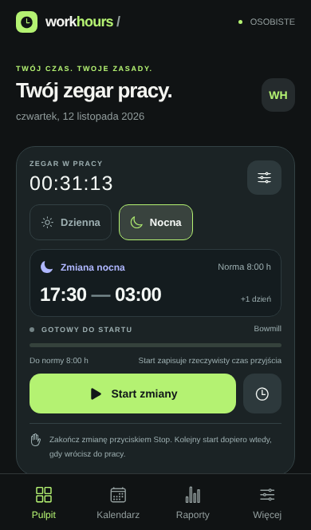
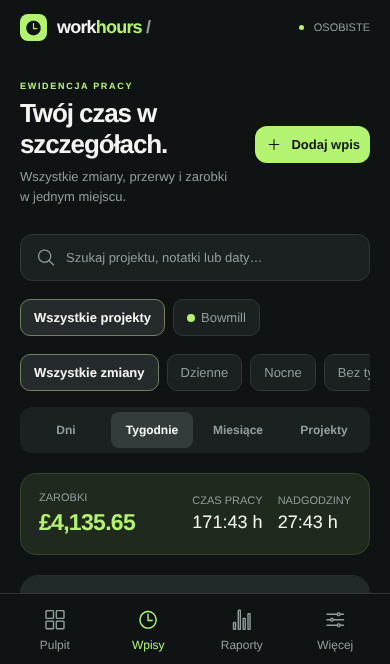

# Work Hours

Osobista aplikacja do ewidencji czasu i zarobków na **Androida i iPhone'a**, napisana w React Native / Expo / TypeScript. Interfejs po polsku, domyślna waluta **GBP**. Działa offline, bez kont i reklam. Dane na każdym urządzeniu są oddzielne.

## Podgląd

Zrzuty podglądu przeglądarkowego na ekranie telefonu, z danymi przykładowymi:

<p>
  
  
  
  
</p>

## Kalendarz i stawki nadgodzin — wersja 1.2

- **Kalendarz** w dolnej nawigacji otwiera miesiąc z godzinami, kwotami i oznaczeniami zmian dziennych/nocnych. Wybierz dzień, aby zobaczyć dokładny czas i zarobki. Strzałki zmieniają miesiąc, a „Dziś” wraca do bieżącej daty.
- Przełącznik **Godziny / Kwoty** zmienia wartości w komórkach. Kwoty w małych komórkach są zaokrąglone; podsumowanie i szczegóły dnia pokazują dokładne wartości do grosza.
- **+** dodaje wpis do wybranego dnia. Zmiana nocna jest widoczna w obu dniach z odpowiadającym im czasem i kwotą. Jej edycja obejmuje całą zmianę.
- **Lista** zachowuje przegląd dni, tygodni, miesięcy i projektów. Filtry projektu, rodzaju zmiany i wyszukiwanie są pod przyciskiem filtrów; dotyczą również kalendarza.
- **Edytuj projekt → Stawka nadgodzin:** wybierz mnożnik (np. ×1,25) lub własną kwotę za godzinę (np. £35). Formularz pokazuje efektywną stawkę zwykłą i nadgodzinową. Zmiana projektu obowiązuje w kolejnych wpisach i licznikach.
- **Edytuj wpis → Stawki tego wpisu:** pozwala świadomie poprawić stawkę wybranej zmiany i przeliczyć tylko ją. Złożenie sekcji nie usuwa wprowadzonych poprawek. Zmiana opisu lub godzin bez edycji stawek zachowuje stawki z historii.
- Eksport CSV zawiera sposób naliczania i efektywną stawkę nadgodzin. Nowe kopie JSON mają **format 3**; kopie 1 i 2 są odczytywane z zachowaniem historii. Nowych kopii używaj w zaktualizowanej aplikacji na obu telefonach.

Przykład: £20/h, nadgodziny £35/h, norma 8 h i 9:30 płatnej pracy = **£212,50**. Dla nocnej 17:30–03:00 kalendarz pokaże **£130** przed północą i **£82,50** po północy, zachowując jedną normę całej zmiany.

## Zmiany dzienne i nocne — wersja 1.1

- **Więcej → Zmiany i norma godzin:** edytuj nazwę, rodzaj, początek, koniec i normę albo dodaj własny profil. Planowana długość i norma są niezależne.
- **Pulpit:** wybierz zmianę i projekt, naciśnij **Start zmiany** przy przyjściu. Zegar zapisuje faktyczny czas, bez zaokrąglania do początku grafiku.
- **Przerwa / Wznów:** przerwa nie wlicza się do normy. Wskaźnik pokazuje czas do normy i nadgodziny.
- **Zakończ zmianę:** zapisuje rzeczywisty koniec. Opcjonalny **Auto-stop** ogranicza czas do najbliższego wystąpienia ustawionej godziny końca. Przed Startem widoczna jest data i godzina końca. Następna zmiana wymaga ponownego naciśnięcia Start.

Przykład: **17:30–03:00, norma 8 h** daje 9:30 pracy bez przerw, czyli 8 h zwykłych i 1:30 nadgodzin. Z 30-minutową przerwą jest to 9 h pracy i 1 h nadgodzin. Można ustawić normę np. **7,5 h**. Północ nie zeruje limitu. Sesje w tym samym projekcie, profilu i dniu zmiany współdzielą normę. Start po północy, przed końcem nocnego planu, należy do poprzedniej nocy.

**Auto-stop po zamknięciu:** zapisany termin ogranicza naliczany czas bez ciągłego działania procesu w tle. Po ponownym otwarciu wpis jest utrwalany z ustawioną godziną końca. To nie jest alarm ani powiadomienie systemowe. Zmiana ustawień nie zmienia aktywnego licznika.

Wpisy mają oznaczenie dzienne/nocne i odpowiednie filtry, a raport miesiąca pokazuje oba rodzaje osobno. Raporty kalendarzowe i CSV dzielą nocną zmianę na dni, zachowując jedną normę i jedną edytowalną zmianę. Wiersze raportu danego dnia pokazują czas i kwotę jego fragmentu.

**Zgodność:** stare kopie wersji 1 i wcześniejsze liczniki są odczytywane automatycznie. Historyczne wpisy zachowują wcześniejsze dzienne reguły i filtr „Bez typu”. Od wersji 1.2 nowe kopie używają formatu 3, który uwzględnia kwotowe stawki nadgodzin. Aktualizacja nie zmienia wcześniejszych zarobków.

Domyślnie: dzienna **06:00–14:00**, nocna **17:30–03:00**, norma **8 h**, ręczny Stop. Auto-stop włącza się osobno w wybranym profilu.

## Pozostałe funkcje

- Projekty / pracodawcy z własną stawką, kolorem i mnożnikiem nadgodzin.
- Start od teraz lub wybranej godziny, niepłatne przerwy, wznowienie i zakończenie zmiany. Licznik zachowuje czas po zamknięciu aplikacji dzięki zapisanym znacznikom czasu.
- Ręczne dodawanie, edycja i usuwanie wpisów, notatki i walidacja nakładających się zmian.
- Przegląd według dni, tygodni, miesięcy i projektów, wyszukiwanie i filtrowanie.
- Obliczanie zwykłych godzin i nadgodzin po odjęciu przerw, ze wspólną normą sesji w projekcie i profilu zmiany.
- Rozdzielanie zmian nocnych na dni raportu. Obliczenia czasu uwzględniają zmianę czasu letniego/zimowego.
- Raport miesiąca, wykres tygodniowy i tygodniowe okresy rozliczeniowe z ręcznym oznaczeniem wypłaty.
- Eksport wszystkich danych ewidencji do CSV, kopia JSON, przywracanie pliku po walidacji i potwierdzeniu.
- Archiwizacja projektów bez usuwania historii. Stawki zapisane przy wpisach zachowują się po zmianie ustawień projektu.
- Opcjonalne, jawnie wczytywane dane przykładowe Bowmill.

## Uruchomienie na telefonie

Wymagane: Node.js 22.13+ (sprawdzono na Node 24), npm i Expo Go zgodne z **Expo SDK 58**.

```sh
npm ci
npm start
```

Zainstaluj zgodne Expo Go na telefonie. Telefon i komputer powinny być w tej samej sieci. Na Androidzie zeskanuj kod QR w Expo Go, na iPhonie aparatem systemowym. Jeśli wydanie Expo Go w sklepie nie obsługuje jeszcze tej wersji SDK, użyj własnego buildu opisanym poniżej. Uruchomienie Expo w tym zdalnym środowisku nie oznacza automatycznie dostępności serwera z telefonu.

Ta aktualizacja dodaje moduły nawigacji. Jeśli korzystasz z własnego wcześniejszego buildu, przebuduj go po aktualizacji zależności; odświeżenie samego JavaScriptu nie doda modułów natywnych. Expo Go wymaga zgodności modułów i wersji SDK.

Podgląd przeglądarkowy:

```sh
npm run web
```

## Własny plik instalacyjny Android / iOS

Projekt jest połączony z kontem **neospecto82**: [Work Hours w Expo](https://expo.dev/accounts/neospecto82/projects/work-hours). Identyfikator EAS jest zapisany w `app.json`, a klucz podpisu Androida jest zarządzany na tym koncie Expo. Repozytorium GitHub przechowuje kod; kompilację uruchamia EAS CLI. Samo wysłanie zmian do GitHuba nie aktualizuje aplikacji zainstalowanej na telefonie.

```sh
npx eas-cli@latest login
npx eas-cli@latest build --platform android --profile preview
```

Profil `preview` tworzy **APK**, które można zainstalować bez Google Play. Dla iPhone'a:

```sh
npx eas-cli@latest device:create
npx eas-cli@latest build --platform ios --profile preview
```

Instalacja iOS na urządzeniu przez dystrybucję wewnętrzną wymaga konta Apple Developer, certyfikatu i rejestracji urządzenia. Alternatywnie testuj w Expo Go. Kompilacje produkcyjne dla Google Play / TestFlight / App Store:

```sh
npx eas-cli@latest build --platform all --profile production
```

Publikacja w sklepach jest osobnym etapem, wymagającym kont właściciela, podpisów i metadanych sklepowych. W tym repozytorium nie ma kluczy ani danych logowania.

## Zasady obliczeń i danych

- Domyślnie nadgodziny zaczynają się po 8 godzinach płatnej pracy na zmianę, mnożnik 1,25. Normę ustawiasz w profilu zmiany, mnożnik w projekcie. Starsze wpisy zachowują reguły dzienne. To proste reguły użytkownika, nie automatyczne odwzorowanie prawa pracy ani umowy.
- Przerwy są niepłatne. Przy wpisie ręcznym przerwa jest umieszczana na końcu zmiany; przy liczniku zapisywane są rzeczywiste przedziały przerw.
- Zmiany nocne są dzielone w raportach na dni według lokalnej strefy telefonu, przy zachowaniu jednej edytowalnej zmiany źródłowej. CSV zawiera osobny wiersz dla każdego dnia zmiany.
- Historia korzysta ze stawki i mnożnika zapisanych przy wpisie. Przy zmianie projektu istniejącego wpisu używane są reguły nowego projektu. Aktywny licznik zachowuje reguły z momentu startu.
- Raportowane zarobki nie uwzględniają podatków, potrąceń ani przewalutowania. Zmiana waluty zmienia oznaczenie wszystkich kwot po potwierdzeniu, nie przelicza wartości.
- Tygodnie: poniedziałek–niedziela. „Opłacono” jest wyłącznie ręczną notatką dotyczącą danego tygodnia; edycja późniejszych wpisów zmienia jego sumę.
- Raporty finansowe obejmują zakończone zmiany. Karta „Dzisiaj” dodaje czas aktywnego licznika; jego zarobki trafiają do raportu po zakończeniu.
- Zapis przez AsyncStorage jest lokalny i nie stanowi szyfrowanego sejfu. Usunięcie aplikacji / danych przeglądarki może usunąć ewidencję. Regularnie zapisuj JSON w bezpiecznym miejscu.
- Przeniesienie między Androidem i iPhonem: zapisz kopię JSON, prześlij plik na drugi telefon i użyj „Przywróć z pliku”. Przywrócenie zastępuje obecne dane. Nie ma automatycznej synchronizacji.

## Kontrole

Sprawdzono: 30 testów domeny, 4 scenariusze Playwright (w tym szerokości 320 i 390 px oraz nocny auto-stop po ponownym otwarciu), lint, TypeScript, eksport Android/iOS/web i 20/20 kontroli Expo Doctor. Testy interfejsu wykonano w Chromium; nie zastępują testów na fizycznym telefonie.

```sh
npm run lint
npm run typecheck
npm test
npm run export
npm run test:e2e
npx expo-doctor
```

`npm run export` sprawdza bundlowanie JS/Hermes dla Androida, iOS i web; nie tworzy podpisanego pliku APK/IPA. Testy domeny sprawdzają naliczanie nadgodzin, podział o północy, zmianę czasu, walidację kopii i eksport. Testy Playwright wymagają zainstalowanego Chromium (`CHROMIUM_PATH`, domyślnie `/usr/bin/chromium`), Pythona 3 i wcześniejszego eksportu do `dist`. Przechodzą przez tworzenie projektu, wpisy, błąd walidacji, przerwę i odtworzenie licznika, rozliczenia i eksport. Zrzuty zapisują do ignorowanego katalogu `artifacts`.

## Zakres i dalsze kroki

To pierwsza działająca wersja oparta na funkcjach ewidencji widocznych na przekazanych zdjęciach i w opisie [WorkingHours](https://play.google.com/store/apps/details?id=partl.workinghours). Nie jest pełną kopią produktu. Nie zawiera GPS/geofencingu, NFC, widżetów systemowych, sterowania w powiadomieniu, synchronizacji chmurowej, integracji kalendarzy, faktur PDF, Pomodoro ani eksportu XLSX. Nie uruchomiono jej jeszcze na fizycznym Androidzie lub iPhonie — wymagane są testy na urządzeniach przed użyciem produkcyjnym.

Kod: `src/domain.ts` — obliczenia i walidacja, `src/storage.ts` — zapis, `src/files.ts` — import i eksport, `src/WorkHoursProvider.tsx` — zapis i domykanie zmian, `src/app/` — trasy Expo Router, `src/screens/WorkHoursScreen.tsx` — ekrany, `src/components/ShiftClock.tsx` — zegar, `src/components/WorkCalendar.tsx` — kalendarz, `src/calendar.ts` — daty siatki miesiąca.
